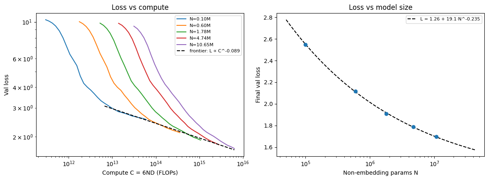

# nanoGPT Scaling Laws on Colab

Five GPT models (0.10M to 10.65M non-embedding parameters) trained from scratch on [TinyStories](https://huggingface.co/datasets/roneneldan/TinyStories), then used to fit a power law of validation loss against model size and compute.

**Everything here was run on Google Colab (free tier) on a single Tesla T4 (15 GB).** Total training time was about 2.3 hours (137.5 min) for all five models.



## Results

| Model | Layers | d_model | Heads | Non-emb. params N | Peak LR | Final val loss | T4 time |
| --- | --- | --- | --- | --- | --- | --- | --- |
| s0 | 2 | 64 | 2 | 0.10M | 3e-3 | 2.549 | 20.5 min |
| s1 | 3 | 128 | 4 | 0.60M | 2e-3 | 2.119 | 22.2 min |
| s2 | 4 | 192 | 4 | 1.78M | 1.5e-3 | 1.909 | 25.8 min |
| s3 | 6 | 256 | 8 | 4.74M | 1e-3 | 1.787 | 30.4 min |
| s4 | 6 | 384 | 8 | 10.65M | 8e-4 | 1.696 | 38.6 min |

Each model trains on the same 100M tokens (6,103 steps × batch 64 × context 256).

Fit of final loss against model size:

```
L(N) = E + A · N^(-α)    →    L = 1.26 + 19.1 · N^(-0.235)
```

| Quantity | Measured | Reference |
| --- | --- | --- |
| α (loss vs. parameters) | **0.235** | Kaplan et al. ≈ 0.076, Chinchilla ≈ 0.34 |
| Irreducible loss E | 1.26 | - |
| Compute-frontier slope (L ~ C^b) | b = -0.089 | - |

A formatted report with all tables and plots is in [`results/nanoGPT_scaling_results.pdf`](results/nanoGPT_scaling_results.pdf).

## Understanding the results (for non-specialists)

- **What was done.** Language models get better when they are made bigger. The question is *how much* better. We trained five models of very different sizes (about 100× from smallest to largest) on the same children's-story text, and measured how well each predicts the next word.
- **What "loss" means.** Loss is how surprised the model is by the real next word, averaged over many words. Lower is better. A model that guesses randomly scores about 10.8. Our models score between 2.5 (smallest) and 1.7 (largest).
- **The main finding.** Loss falls along a smooth, predictable curve as models grow (right panel of the plot). Because the curve is regular, a few small, cheap models can be used to forecast what a larger one would achieve.
- **The exponent α = 0.235.** It says how quickly extra size pays off: making a model 10× bigger shrinks the "still improvable" part of the loss by about 1.7×. The gains are real but get smaller with every step.
- **The floor E = 1.26.** Even an infinitely large model could not go below this on this data, because text always contains some randomness. The fit says we are already within about 0.4 of that floor with the biggest model.
- **The left panel (loss vs. compute).** Each coloured line is one model as it trains; the x-axis is the total amount of computation spent. Small models improve fastest early on, but larger models overtake them once enough compute is spent. The dashed black line, the lower edge of all curves, shows the best loss achievable for a given compute budget.
- **How it compares.** Our α falls between the two best-known published values (0.076 and 0.34). They were measured on different data, model families and methods, so the comparison is rough, not a replication.

### Caveats

- Five models, one random seed each. A three-parameter fit to five points is fragile; α and E trade off against each other.
- All models saw the same 100M tokens, so the biggest ones are probably under-trained and the setup is not compute-optimal.
- Learning rates were chosen by hand, not tuned per size.
- The plain log-log slope between the two largest models is only about 0.065 (≈ 0.087 across all five), so the exponent depends on how E is treated.
- TinyStories is simple synthetic text. Exponents on web-scale text can differ.

## Setup

- **Hardware:** Google Colab, runtime type **T4 GPU** (`Tesla T4`, 15360 MiB). The T4 has no bf16, so training uses fp16 autocast with a GradScaler.
- **Model:** GPT-2-style decoder, pre-LayerNorm, GELU MLP, tied embeddings, flash attention (`F.scaled_dot_product_attention`), context 256, GPT-2 BPE vocabulary padded to 50,304. N counts non-embedding parameters.
- **Training:** AdamW (β = 0.9, 0.95, weight decay 0.1), 5% warm-up then cosine decay to 10% of peak LR, gradient clipping 1.0, 30 log-spaced validation points per run, compute estimated as C = 6·N·D.
- **Data:** TinyStories, tokenized once with `tiktoken` into `uint16` files on Google Drive.

## Reproduce

1. Open [`nanogpt_scaling_laws.ipynb`](nanogpt_scaling_laws.ipynb) in Colab and set **Runtime → Change runtime type → T4 GPU**.
2. Run all cells. Data and per-model results are saved to Google Drive (`/content/drive/MyDrive/scaling`), and finished models are skipped on rerun, so a disconnect loses at most one run.
3. Cell 5 fits the scaling law and writes `scaling.png`.

Running outside Colab: `pip install -r requirements.txt`, remove the Drive-mount lines and point `ROOT` at a local folder. Expect a long run without a GPU.

To rebuild the PDF report from the saved logs:

```bash
python results/make_report.py
```

## Repository layout

```
nanogpt_scaling_laws.ipynb          # full pipeline: setup, data, model, training, fit, plot
nanoGPT Scaling Laws on Colab.md    # project write-up / design notes
requirements.txt
results/
  scaling.png                       # headline figure
  training_curves.png               # validation loss vs. tokens per model
  train_logs.json                   # validation losses and timings parsed from the Colab run
  nanoGPT_scaling_results.pdf       # formatted results report
  make_report.py                    # rebuilds the report
```

## References

- Kaplan et al., *Scaling Laws for Neural Language Models*, 2020 ([arXiv:2001.08361](https://arxiv.org/abs/2001.08361))
- Hoffmann et al., *Training Compute-Optimal Large Language Models* (Chinchilla), 2022 ([arXiv:2203.15556](https://arxiv.org/abs/2203.15556))
- Eldan & Li, *TinyStories*, 2023 ([arXiv:2305.07759](https://arxiv.org/abs/2305.07759))
